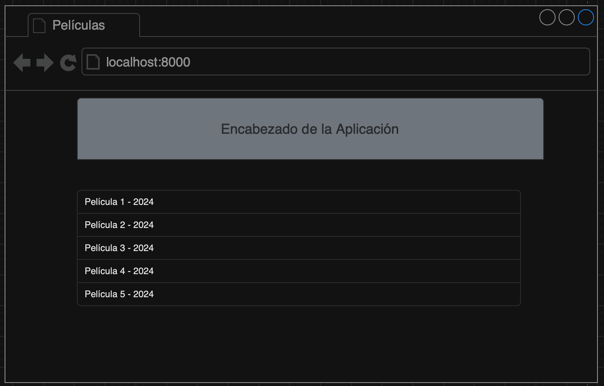
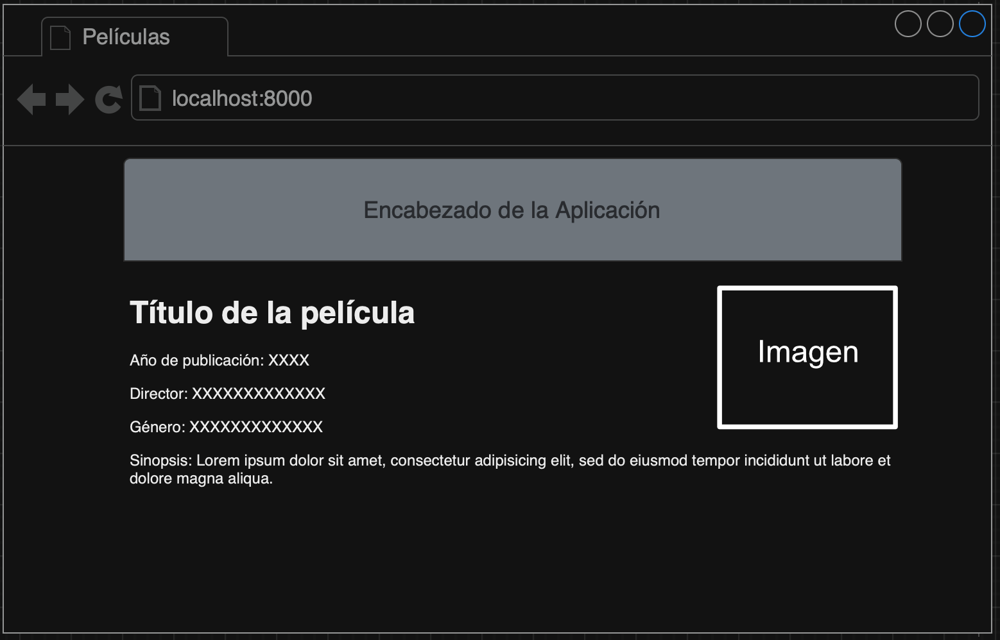

# Examen Parcial 1. Django: Vistas, Templates y Modelos

En el presente examen se evaluarán los conocimientos de los estudiantes sobre el desarrollo de interfaces web utilizando el patrón Modelo-Vista-Template (MVT) con Django, HTML y CSS.

Para el examen se propone crear un catálogo de películas que se mostrarán en una vista Maestro - Detalle.

## Datos del estudiante
- [Nombres y apellidos]

## Objetivos 

### 1. Manejo de Modelos en Django
El estudiante debe ser capaz de definir modelos en Django con los campos y tipos de datos apropiados, generar migraciones y administrar los registros mediante el administrador de Django.

### 2. Conexión y Manejo de Bases de Datos
El estudiante debe comprender la conexión de Django con una base de datos relacional y utilizar el ORM para consultar los datos almacenados.

### 3. Despliegue de Datos Reales en Interfaces Web
El estudiante debe ser capaz de mostrar datos reales de la base de datos en vistas de listado y detalle, utilizando templates de Django, HTML y Bootstrap para construir y estilizar las páginas.

### 4. Comprensión de las Capas de Django
El estudiante debe demostrar su conocimiento del patrón Modelo-Vista-Template (MVT), identificando las responsabilidades de cada capa y cómo interactúan para procesar solicitudes y presentar datos.

## Reglas del examen
Los estudiantes podrán usar los recursos usados en clase tales como laboratorios, diapositivas, apuntes. Así como consultas en StackOverflow y sitios de consulta para desarrolladores.

**No se permite el uso de: Chats como Whatsapp, Microsoft Teams, Google Chat, Telegram, entre otros; así como tampoco se permite el uso de inteligencia artificial generativa**

Las consultas sobre cualquier inquietud se deberá hacer únicamente al docente.

**Cualquier intento de fraude anulará el presente examen, pasará al registro con la nota de Cero y se informará a la coordinación de la carrera para tomar las acciones pertinentes de acuerdo al reglamento de la institución**.

## Tareas a realizar

1. **Generación de Modelos 'Movie'.** El modelo representa una película deberá tener los siguientes atributos.
    - Id
    - Título de la película
    - Género de la Película
    - Nombre del director de la película
    - Año de publicación
    - Sinopsis (Utilizar tipo TextField para este campo)
    - Imagen de la película (Utilizar tipo ImageField para este campo)

    **Nota:** Los nombres de los atributos deben ser creados en inglés y siguiendo las convenciones de PEP8 usadas durante el curso

2. **Generación de migraciones.** El estudiante debe generar las migraciones para generar las tablas en la base de datos
3. **Añadir model a la vista de administrador de Django.** El modelo deberá poder ser administrado en la aplicación '/admin' de Django
4. **Despliegue de listado películas (index).** Las películas que se encuentran en la base de datos se deberán mostrar en la pantalla inicial de la aplicación de la siguiente manera:
    - Nombre de la película - Año de publicación
    - El sitio web deberá tener una cabecera con el título del sitio y utilizar los estilos de Bootstrap indicados en los requerimientos técnicos.

    A continuación se muestra un bosquejo del listado de las películas.


5. **Despliegue de Detalles de película.** Al momento de seleccionar una película del listado especificado en el paso anterior, el estudiante deberá mostrar los detalles de la película seleccionada. Esta deberá mostrar todos los campos declarados en el modelo.

    A continuación se muestra un bosquejo de los detalles de las películas.


6. **Rutas.** El acceso a las rutas y los enlaces de las mismas quedan a criterio del estudiante

## Entrega del trabajo

Desde la raíz del repositorio, guarda los cambios y súbelos al repositorio remoto:

```bash
git add .
git commit -m "Entrega del examen"
git push
```

Verifica en el repositorio remoto que los cambios se hayan publicado.

## Requerimientos Técnicos Obligatorios

- **Patrón MVT (Modelo-Vista-Template):** Es obligatorio implementar la arquitectura MVT de Django. Las vistas deben procesar la lógica de negocio y los templates deben presentar los datos.

- **Estilos CSS:** Es obligatorio utilizar **Bootstrap** (versión 5 o superior). Cada estudiante debe crear un tema personalizado en [Bootstrap.build](https://bootstrap.build/), descargar el CSS generado y colocarlo en el directorio de archivos estáticos de Django. El tema debe cargarse en los templates mediante la etiqueta `static` y aplicarse al sitio. Los estilos CSS adicionales deben estar separados del HTML en archivos `.css` independientes.

## Requerimientos del entorno

- Docker Desktop (Windows / macOS) o Docker Engine + Compose (Linux)
- Git instalado y acceso al repositorio remoto para entregar el trabajo
- PostgreSQL 17 (incluido en Docker)
- No necesitas Python, entornos virtuales ni PostgreSQL instalados en tu equipo

## Instalación y Uso con Docker

### Levantar el entorno
Desde la raíz del repositorio:

```bash
docker compose up --build
```

El backend queda disponible en: <http://localhost:8001>

Al iniciar, las migraciones se ejecutan automáticamente. El código está montado como volumen, así que los cambios en tu editor se recargan solos.

### Acceder a pgAdmin (Administrador de Base de Datos)
- **URL:** <http://localhost:5050>
- **Email:** `admin@movies.com`
- **Contraseña:** `admin`

Para conectar el servidor en pgAdmin:
- **Host:** `db`
- **Puerto:** `5432`
- **Base de datos:** `movies`
- **Usuario:** `movies`
- **Contraseña:** `movies`

### Comandos de Django con Docker

Todos los comandos de Django se ejecutan dentro del contenedor. Con los contenedores encendidos, usa:

| Tarea | Comando |
|---|---|
| Crear una app | `docker compose exec backend python manage.py startapp <nombre>` |
| Generar migraciones | `docker compose exec backend python manage.py makemigrations` |
| Aplicar migraciones | `docker compose exec backend python manage.py migrate` |
| Crear superusuario | `docker compose exec backend python manage.py createsuperuser` |
| Shell de Django | `docker compose exec backend python manage.py shell` |
| Ejecutar tests | `docker compose exec backend python manage.py test` |
| Ver SQL de migración | `docker compose exec backend python manage.py sqlmigrate <app> <numero>` |

Si el backend está apagado, levántalo junto con sus dependencias:

```bash
docker compose up -d backend
```

Después, ejecuta podrás ejecutar cualquiera de los comandos indicados anteriormente del contenedor.

### Gestión de Dependencias

Para instalar nuevas librerías:

```bash
docker compose exec backend pip install <nombre_paquete>
docker compose exec backend pip freeze > requirements.txt
docker compose up -d --build backend
```

### Logs y Reinicio

```bash
docker compose logs -f backend
docker compose restart backend
```

### Acceso a la Base de Datos

Conectar a PostgreSQL directamente desde la línea de comandos:

```bash
docker compose exec db psql -U movies -d movies
```

### Detener el entorno

```bash
docker compose down
```

Para reiniciar la base de datos desde cero (borra todos los datos):

```bash
docker compose down -v
docker compose up --build
```

## Configuración en settings.py

La conexión a la base de datos ya está configurada automáticamente a través de variables de entorno definidas en `docker-compose.yml`:

```python
DATABASES = {
    'default': {
        'ENGINE': 'django.db.backends.postgresql',
        'NAME': os.environ.get('POSTGRES_DB', 'movies'),
        'USER': os.environ.get('POSTGRES_USER', 'movies'),
        'PASSWORD': os.environ.get('POSTGRES_PASSWORD', 'movies'),
        'HOST': os.environ.get('POSTGRES_HOST', 'localhost'),
        'PORT': os.environ.get('POSTGRES_PORT', '5432'),
    }
}
```

**Nota:** Dentro de Docker, el host de la base de datos es `db` (el nombre del servicio en el compose), no `localhost`.

## Problemas Frecuentes

- **`connection refused` a la base de datos:** espera a que `db` esté *healthy*. Ejecuta `docker compose ps` y verifica que `db` tenga el estado `healthy`.
- **Puerto 8001 ocupado:** detén el proceso que lo usa o cambia el puerto del host en el mapeo `"8001:8000"` en el compose.
- **Windows, error `^M` o `exec format error`:** configura `git config core.autocrlf input` y vuelve a clonar.
- **Cambié `requirements.txt` y no lo ve:** reconstruye con `docker compose up -d --build backend`.